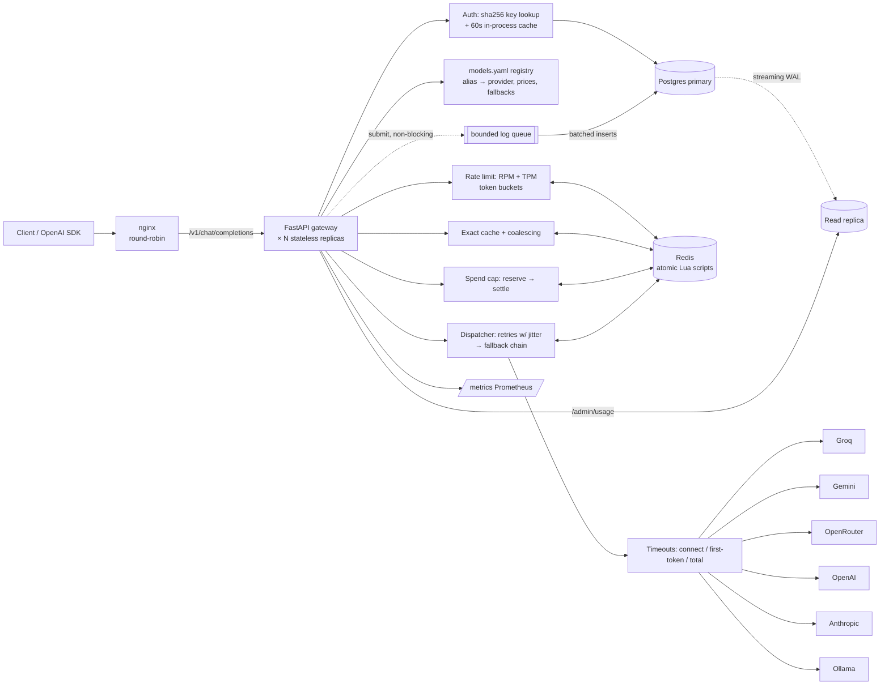
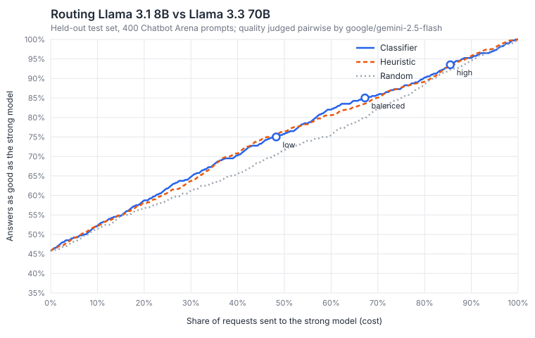

# LLM Gateway

An OpenAI-compatible gateway that sits between apps and LLM providers. Apps point any OpenAI SDK
at it. The gateway handles auth, provider translation, streaming, timeouts and cost/latency
logging, plus retries, fallback chains, a shared circuit breaker, per-key rate limits and
spend caps, a response cache with request coalescing, and `model: "auto"` routing between a
cheap and a strong model. A dashboard is coming (see Status).

```python
from openai import OpenAI

client = OpenAI(base_url="http://localhost:8000/v1", api_key="gw-...")
client.chat.completions.create(model="gemini-flash", messages=[{"role": "user", "content": "hi"}])
```

## Architecture



- **Adapters** translate OpenAI format ⇄ native format, including streaming events, tool calls,
  images and token usage. They normalize upstream errors into `RateLimited`, `ProviderUnavailable`,
  `ProviderTimeout`, `BadRequest` and `AuthError`.
- **Failover:** retryable errors (429, 5xx, timeouts) are retried with backoff and jitter, then
  the request moves down the alias's fallback chain. Client errors are never retried.
- **Streams are primed:** the gateway waits for the first *content* chunk before committing to a
  200. Failures before that point fail over invisibly; after it, the stream ends with an error
  event. It never splices one model's output onto another's.
- **Circuit breaker per provider:** state lives in Redis via atomic Lua scripts, so all replicas
  share it and only one request probes a recovering provider. If Redis is down it fails open.
- **Rate limits:** per-key RPM and TPM token buckets, checked together in one Lua script. TPM
  is charged up front with an estimate and refunded after the request.
- **Spend caps:** before calling upstream, atomically reserve the worst case (the priciest model
  in the fallback chain); after, settle the actual cost. Parallel requests can never jointly
  exceed the cap. Fails closed (503) if Redis is down.
- **Cache:** exact match for `temperature: 0` (or `X-Gateway-Cache: force`). 100 identical
  concurrent requests make **one** upstream call (the others wait for it). Hits cost $0 and can
  be replayed as a stream. Fails open.
- **Usage:** if a provider doesn't report token usage, the gateway counts tokens with tiktoken and
  flags the row `usage_estimated`.
- **Money is `Decimal` everywhere**, with prices per 1M tokens in `models.yaml`.

Response headers: `X-Gateway-Provider`, `X-Gateway-Model`, `X-Gateway-Alias` (the alias that
served the request), `X-Gateway-Fallbacks`, `X-Gateway-Attempts`, `X-Gateway-Cost-USD`
(non-streaming), `X-Gateway-Request-Id`, `X-Cache: HIT|MISS|BYPASS`, `X-RateLimit-Limit` /
`-Remaining` (and `-Tokens` variants), `Retry-After` on 429.

Errors: 401 bad key · 402 spend cap · 403 model not allowed · 404 unknown model ·
429 rate limit · 502/504 upstream failure after retries and fallbacks · 503 no provider
available or limiter down.

Design decisions: [`docs/decisions/`](docs/decisions/)

## Run it

```bash
cp .env.example .env            # add GEMINI_API_KEY / OPENROUTER_API_KEY / GROQ_API_KEY
docker compose up -d --build    # nginx + api + postgres (+ replica) + redis; migrations run once
docker compose up -d --scale api=3 && docker compose restart nginx   # 3 gateway replicas
# set ADMIN_TOKEN in .env, then create a key (the raw key is shown once):
curl localhost:8000/admin/keys -H "Authorization: Bearer $ADMIN_TOKEN" -H 'content-type: application/json'   -d '{"name":"me","rpm_limit":60,"tpm_limit":100000,"monthly_spend_cap_usd":"5"}'
GATEWAY_KEY=gw-... uv run python scripts/smoke_openai_sdk.py --aliases gemini-flash,or-llama-8b
```

Admin API (Bearer `ADMIN_TOKEN`; disabled while it's the placeholder):
- `POST /admin/keys`, `GET /admin/keys`, `PATCH /admin/keys/{id}` (e.g. `{"active": false}`).
- `GET /admin/usage`: cost, tokens, p50/p95 latency, cache hits, errors per key and alias.

- `GET /healthz`: liveness.
- `GET /readyz`: readiness plus a dependency report.
- `GET /metrics`: Prometheus.

The `ollama-llama-8b` alias works with a local Ollama and no API keys: Compose points
`OLLAMA_BASE_URL` at the host.

## Benchmarks

Measured with k6 against a mock upstream with 100 ms latency, so these numbers are the gateway
only. Every request takes the full path (auth, RPM/TPM limits, spend reserve and settle,
breaker, logging). Run on one laptop under Docker Desktop. Details and analysis:
[`loadtest/RESULTS.md`](loadtest/RESULTS.md).

| | 1 replica | 2 replicas | 3 replicas |
|---|---|---|---|
| Max sustained RPS | 80 | 145 (1.81×) | 190 (2.38×) |
| Gateway overhead p50 / p99 (moderate load) | 3.7 / 6.7 ms | 3.7 / 6.1 ms | 3.6 / 5.9 ms |

- **The bottleneck is each replica's CPU** (one event loop per replica, ~98% at saturation).
  Redis (~20%), Postgres (≤ 27%) and nginx (< 10%) have headroom.
- **Profiling:** our code is ~4% of CPU per request; the rest is network round trips through
  the Python async stack. Cutting Redis round trips from 6 to 4 reduced CPU per request by ~22%.
- **Killing a replica under load: 100% success**, after fixing two nginx/uvicorn timeout bugs the
  load test exposed (60 s connect timeout; keep-alive mismatch causing reset POSTs).

## Smart routing (`model: "auto"`)

```python
client.chat.completions.create(model="auto", messages=[...])
# -> X-Gateway-Route: cheap | strong, X-Gateway-Route-Reason, X-Gateway-Route-Probability
```

- **Hard rules decide first:** required features (tools / vision / JSON), context length,
  provider circuit state, remaining budget.
- **Otherwise a classifier decides:** logistic regression over int8 bge-small prompt
  embeddings, which predicts P(the cheap model's answer is as good as the strong one). Each key
  picks a threshold via `routing_quality`: `low` / `balanced` / `high`.
- **The labels come from the project's own data:** 2,000 Chatbot Arena prompts, answered by
  Llama 3.1 8B and Llama 3.3 70B, then judged pairwise by Gemini 2.5 Flash in both answer
  orders. That cost $1.72 in total, and every generation is cached and committed.
  `uv run --extra router --group eval python -m eval.run` reproduces every number and the chart
  without API calls.



**Result, stated honestly:** for this model pair, the classifier (APGR 0.537) does **not**
significantly beat a length/code/math heuristic (0.532). The 95% CI of the difference spans
zero, and both are only slightly better than random (0.5). A train-only model-selection study
(MLP, kNN, extra features) found nothing better either.

The same-family 8B and 70B models fail on the same prompts, and 27% of judge verdicts depend on
answer order, so the prompt carries little routing signal. This matches RouteLLM's findings for
Arena-only training data. The analysis and what would change it:
[`eval/RESULTS.md`](eval/RESULTS.md), [ADR 0012](docs/decisions/0012-smart-routing.md).

Routing latency is 18–48 ms on this laptop's CPU, above the 10 ms target, and it's skipped
entirely for cache hits and rule-based decisions. The ADR has the measurements and the
trade-off.

## Load test

```bash
uv run python loadtest/run.py   # mock upstream (100 ms) + k6; 1 -> 2 -> 3 replicas; writes loadtest/RESULTS.md
```

The load-test overlay points the gateway at a local mock LLM and blanks every real provider key,
so a load test can never reach or bill a real provider. Results: [`loadtest/RESULTS.md`](loadtest/RESULTS.md).

## Develop

```bash
uv sync
uv run ruff check . && uv run ruff format --check . && uv run mypy && uv run pytest
docker compose up -d postgres redis && uv run alembic upgrade head && uv run pytest -m integration
```

Tests mock all provider HTTP with `respx`. No real API calls happen in tests or CI.

## Status

| Milestone | State |
|---|---|
| **M1:** core proxy, adapters (Groq, Gemini, OpenAI, Anthropic, OpenRouter, Ollama), streaming, auth, request logging, Compose, CI | done; see verification below |
| **M2a:** retries, fallback chains, Redis circuit breaker, `/readyz` | done |
| **M2b:** rate limits, spend limits (reserve then settle), cache with coalescing, admin API | done |
| **M2c:** Postgres read replica, 3 replicas behind nginx, DB outage handling, k6 load tests | done; see `loadtest/RESULTS.md` |
| **M3:** `model: "auto"` routing: rules, classifier, per-key quality, reproducible eval (RouteLLM metrics) | done; classifier ≈ heuristic for this model pair (see above) |
| **M4:** dashboard and playground | |

### M1 verification
- The official OpenAI SDK runs against the gateway (streaming and non-streaming) in tests with
  mocked providers.
- Real Gemini (2.5 Flash, 3.1 Flash Lite) and OpenRouter (Llama 3.1 8B) through the SDK:
  streaming and non-streaming pass. *Pending: Groq key.*
- Local Ollama `llama3.1:8b` through Docker Compose: streaming TTFT 321ms. Rows were written to
  `requests` with tokens, cost, latency and TTFT. A client disconnect mid-stream was logged as
  `client_disconnected`.

### M2a verification
- 107 unit tests and 9 integration tests (real Redis and Postgres). The integration tests
  include a 50-way race for the half-open probe across 5 connections: exactly 1 wins.
- Live failover: the free Gemma model on OpenRouter returned 429 → 2 attempts → served by
  Gemini Flash Lite (`X-Gateway-Fallbacks: 1`, `X-Gateway-Attempts: 3`).
- Live fail-open: `docker compose stop redis` → chat requests still 200, Redis errors counted in
  `/metrics`, `/readyz` reports `degraded` and stays 200 (see ADR 0007).

### M2b verification
- 123 unit tests and 27 integration tests (real Redis and Postgres). The integration suite
  passed 8 runs in a row.
- **3 gateway instances, one Redis:**
  - 60 concurrent requests at `rpm=10` → exactly 10 × 200;
  - `tpm=1000` → exactly the 9 that fit;
  - 40 parallel requests against a $0.001 cap → exactly the 6 that fit (worst case $0.0001525);
  - **100 identical requests → 1 upstream call.**
- Live (real OpenRouter): cache miss 1,013ms → hit **15ms** at $0. A key with no `max_tokens`
  got a 402, because its worst case ($0.001538, priced at the fallback model) exceeded the cap.
  The 4th request in a minute at `rpm=3` got a 429 with `Retry-After: 18`.
- Found while testing: Docker Desktop's Redis clock steps back by ~1s every few seconds. The
  rate limiter and breaker now handle backward clock steps (ADRs 0006 and 0008).

### M2c verification
- Streaming Postgres replica (`pg_basebackup -R`). Dashboard reads go to the replica, which
  falls back to the primary when it's down (tested live).
- Primary down: known keys keep working (stale-if-error), unknown keys get 503, and request logs
  buffer and then flush, with all rows recovered (tested live).
- k6 sweep for 1/2/3 replicas, a streaming run and a replica-kill run; see the benchmarks above.
